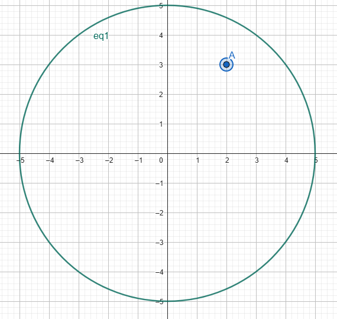
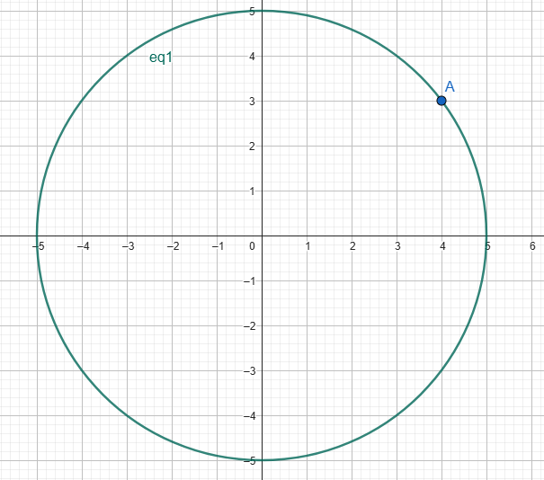
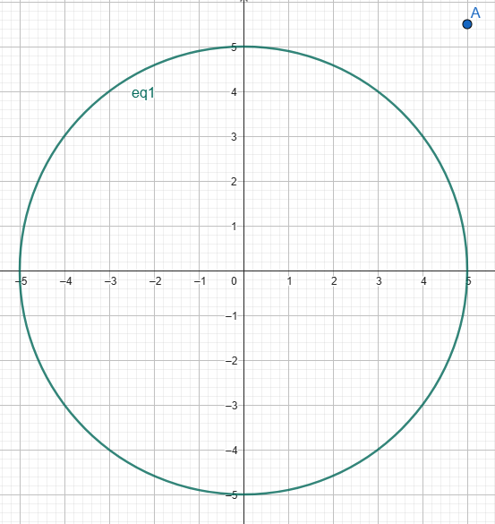

# Условни конструкции
Когато пишем дадена програма е доста удобно да изпълним дадено парче код при някакво условие и друго парче код при друго условие. 
Нека си представим, че искаме да решим следната задача: </br></br>
*Въвежда се число X. Ако то е положително - умножи го по 10 и го принтирай, а ако е отрицателно - принтирай някаква грешка.* </br> </br>
Напълно интуитивно, решението би било нещо от сорта: </br>
```c++
ако X > 0, то x *= 10 и cout << x;
иначе, cout << "error";
``` 

В С++ съществуват такива средства за изпълнение на различни парчета код в зависимост от дадено условие и те се наричат **условни конструкции**. 
## If-else
Синтаксис: 
```c++
if (<условие>) {
    // кодът тук ще изпълни, ако условието е истина
}
else {
    // кодът тук ще се изпълни, ако условието е лъжа
}
```
***else блокът може да бъде само един и не е задължителен, тоест може и да се пропусне***

## Живот на променливите
Всяка променлива, която създаваме, може да бъде използвана (достъпвана) само в определена част от кода. Тоест, можем да кажем, че променливата има определен "живот", който започва
с нейното създаване и приключва някъде другаде из кода. Въпросът е къде приключва нейният живот.

*Блок* ще наричаме кода между две къдрави скоби (отваряща и затваряща). Всяка променлива "живее" в определен блок, като тя е видима от момента на създаването си до края на
блока, в който е създадена. Променливите са видими и във вложените блокове на блока, в който са създадени. 

Променливи с едно и също име може да съществуват във вложени блокове, като променливата, която е видима, е най-дълбоко дефинираната. Например, и в главния scope, и
в блок 3 съществуват променливи с името *a*. От момента на създаването на по-вътрешната променлива *a* (тази в блок 3) до края на блок 3, видимата променлива ще е вътрешната. 
Във всеки друг случай ще е външната (тази в главния scope).


## If-else if-else
Синтаксис: 
```c++
if (<условие1>) {
    // кодът тук ще се изпълни, ако условието е истина
}
else if (<условие2>) {
    // кодът тук ще се изпълни, ако условие1 е лъжа, а условие2 е истина
}
else {
    // кодът тук ще се изпълни, ако условие1 е лъжа и условие2 е лъжа
}
```
***else блокът и else-if блоковете не са задължителни, тоест може и да се пропуснат***
## Switch statement
Синтаксис: 
```c++
switch (<целочислена стойност или променлива>) {
    case value1:
        код1; // кодът тук ще се изпълни, ако стойността / стойността на променливата е равна на value1
    break;
    case value2:
        код2; // кодът тук ще се изпълни, ако стойността / стойността на променливата е равна на value2
    break;
    case value3:
        код3; // кодът тук ще се изпълни, ако стойността / стойността на променливата е равна на value3
    break;
    default:
        кодN; // кодът тук ще се изпълни, ако не сме влезли в нито един case
    break;
}
```
Под "целочислена стойност или променлива" се има предвид стойност или променлива от тип char, short, int, long long, unsigned вариантите им и bool.

Когато влезем в някой case, изпълняваме код, докато не видим break или switch блокът не свърши. Изпускайки break можем да правим и така нареченото *пропадане* на случаите, което
ни позволява да изпълняваме еднакъв код за много case-ове.

Например кодът долу ще принтира "Working day" за всеки ден от седмицата с номер между 1 и 5 (понеделник-петък) и "Weekend" за всеки ден от седмицата с номер 6 или 7 (събота или неделя):
```c++
#include <iostream>

int main() {
    unsigned day;
    std::cin >> day;

    switch (day) {
        case 1:
        case 2:
        case 3:
        case 4:
        case 5:
            std::cout << "Working day";
            break;
        case 6:
        case 7:
            std::cout << "Weekend";
            break;
        default:
            std::cout << "Invalid day!";
    }
}
```
В този случай например, ако въведем числото 3, ще влезем в case-а, който отговаря за стойността 3 и ще изпълняваме всичко надолу, докато не видим break. В този ред на мисли можем да кажем,
че е излишно да се слага break след default, тъй като 

### С какво switch се различава от if-else if-else
⚠️ *Това е допълнителен материал, излизащ доста извън рамките на курса. Препоръчително е да прочетете нещата по долу, за да придобиете разбиране как работи езикът C++ на по-ниско ниво.*

<details>
<summary><h4>Обяснение</h4></summary>

За да разберем каква е разликата между switch и if-else, трябва да знаем поне на базово ниво как работи компилацията. Когато напишем някакъв код на C++, той минава процес на 
*компилация*, който превръща кода ни на C++ в машинен код. Една от стъпките на компилацията е така нареченото *генериране на код* (code generation), при което на база даден
C++ код се създава assembly код. Assembly наричаме език на изключително ниско ниво, който все още е четим от човек, но много прилича на реалните инструкции 
на дадената компютърната архитектура. 

Нека разгледаме следния код на C++:
```c++
int main() {
    int a = 2, b = 3;
    int c = a + b;
}
```

Генерираният код на assembly за [RISC-V](https://riscv.org/) архитектурата изглежда така:
```asm
main:
    addi    sp,sp,-32
    sw      ra,28(sp)
    sw      s0,24(sp)
    addi    s0,sp,32

# main starts here
    li      a5,2
    sw      a5,-20(s0)
    li      a5,3
    sw      a5,-24(s0)
    lw      a4,-20(s0)
    lw      a5,-24(s0)
    add     a5,a4,a5
    sw      a5,-28(s0)
# main ends here

    li      a5,0
    mv      a0,a5
    lw      ra,28(sp)
    lw      s0,24(sp)
    addi    sp,sp,32
    jr      ra
```
Думите li, sw, lw, add, jr и т.н. се наричат mnemonics (кратки, четими от човек съкращения, които описват инструкции на процесора на ниско ниво), а думите a5, a4, s0, ra, sp 
се наричат регистри (малки и бързи за достъпване места за съхранение на данни директно в процесора). За регистрите може да си мислите като за променливи.
Тук се случва следното:
- в регистър a5 се зарежда стойността 2
- стойността, съхранявана в регистър a5, се запазва на мястото в паметта на програмата, определено за променливата a
- в регистър a5 се зарежда стойността 3
- стойността, съхранявана в регистър a5, се запазва на мястото в паметта на програмата, определено за променливата b
- в регистър a4 се зарежда стойността на променливата a (четем от там, където тя се съдържа в паметта на програмата)
- в регистър a5 се зарежда стойността на променливата b (четем от там, където тя се съдържа в паметта на програмата)
- към регистър a5 се добавя стойността на регистър a4 (ефективно вече регистър a5 съдържа сумата на стойностите на променливите a и b)
- стойността, съхранявана в регистър a5, се запазва на мястото в паметта на програмата, определено за променливата c

#### Оптимизации
Преди генерирането на финалния assembly код, компилаторът може да прави така наречените *оптимизации*, с които цели да направи крайния
генериран код по-бърз и ефективен за изпълнение. Една от най-често срещаните оптимизации е това изрази, чиято стойност е константна, да бъдат пресмятани още по време на компилация, за
да не се налага това да се случва по време на изпълнение на програмата. 
```c++
int a = 2 + 3;
```
Например тук компилаторът ще види, че събираме две константи (самите числа 2 и 3) и вместо да генерира код за сумирането на двете числа, просто ще извърши сумирането, ще замести
изразът вдясно с числото 5 още преди да се генерира кода и по такъв начин C++ кодът ни ще стане:
```c++
int x = 5;
```

А assembly кодът ще изглежда така:
```asm
main:
    addi    sp,sp,-32
    sw      ra,28(sp)
    sw      s0,24(sp)
    addi    s0,sp,32

# main starts here
    li      a5,5
    sw      a5,-20(s0)
# main ends here

    li      a5,0
    mv      a0,a5
    lw      ra,28(sp)
    lw      s0,24(sp)
    addi    sp,sp,32
    jr      ra
```
Тук се извършват 2 инструкции - първата зарежда числото 5 в регистър a5. Втората запазва стойността, съхранявана в регистър a5 на мястото в паметта на програмата, определено
за променливата x.

#### if-else if-else в assembly
Нека разгледаме следния C++ код:
```c++
#include <iostream>

int main() {
    int a;
    std::cin >> a;

    if (a == 1) {
        std::cout << "A";
    }
    else if (a == 2) {
        std::cout << "B";
    }
    else {
        std::cout << "Error";
    }
}
```

Assembly кодът, който се генерира (и в който съм махнал голяма част от нерелевантните за момента детайли), е следният:
```asm
main:
        addi    sp,sp,-32
        sw      ra,28(sp)
        sw      s0,24(sp)
        addi    s0,sp,32

        # ...
        # condition check 1 starts
        lw      a4,-20(s0)
        li      a5,1
        bne     a4,a5,.L2
        # condition check 1 ends

        # printing "A"
        j       .L3
.L2:
        lw      a4,-20(s0)
        li      a5,2
        bne     a4,a5,.L4
        # printing "B"
        j       .L3
.L4:
        # printing "C"
.L3:
        # ...
```
Това, което ни интересува, е кодът между коментарите "condition check 1...". Редовете, завършващи с двоеточие, се наричат етикети (labels) и ни позволяват директно да
прескачаме от едно място в кода към друго. Случва се следното:
- в регистър a4 се зарежда стойността на променливата a от паметта
- в регистър a5 се зарежда стойността 1
- прави се проверка дали стойността в регистър a4 е различна от стойността в регистър a5. Ако са различни, скачаме на реда, на който е етикетът .L2. В противен случай продължаваме
изпълнението от мястото, на което сме, надолу.

В случая, ако стойностите в двата регистъра са еднакви, ще продължим с изпълнението надолу и ще принтираме "A", след което ще скочим безусловно на етикетът .L3, който бележи край на условната
конструкция. Ако пък стойностите са различни, скачаме на етикетът .L2, който бележи началото на else-if частта.

Подобно зареждане на стойности и проверка правим и тук, като тук обаче ще проверим дали двата регистъра съдържат различни стойности, като вторият (a5) ще съдържа стойността 2.
Ако стойностите са равни, то принтираме "B" и скачаме безусловно на етикетът .L3. Ако пък са различни, скачаме на етикетът .L4, който бележи началото на else частта. Тук принтираме "C"
и продължаваме директно към етикетът .L3 и с това условната конструкция приключва.

#### switch в assembly
Нека разгледаме следния C++ код:
```c++
#include <iostream>

int main() {
    int a;
    std::cin >> a;

    switch (a) {
        case 1:
          std::cout << "A";
        break;
        case 2:
          std::cout << "B";
        break;
        case 3:
          std::cout << "C";
        break;
        case 4:
          std::cout << "D";
        break;
        case 5:
          std::cout << "E";
        break;
        default:
          std::cout << "Error";
    }
}
```

Assembly кодът, който се генерира (и в който отново съм махнал голяма част от нерелевантните за момента детайли), е следният:
```asm
main:
        addi    sp,sp,-32
        sw      ra,28(sp)
        sw      s0,24(sp)
        addi    s0,sp,32

        # ...
        # switch starts here
        lw      a5,-20(s0)
        li      a4,5
        beq     a5,a4,.L2
        li      a4,5
        bgt     a5,a4,.L3
        li      a4,4
        beq     a5,a4,.L4
        li      a4,4
        bgt     a5,a4,.L3
        li      a4,3
        beq     a5,a4,.L5
        li      a4,3
        bgt     a5,a4,.L3
        li      a4,1
        beq     a5,a4,.L6
        li      a4,2
        beq     a5,a4,.L7
        j       .L3
.L6:
        # printing "A"
        j       .L8
.L7:
        # printing "B"
        j       .L8
.L5:
        # printing "C"
        j       .L8
.L4:
        # printing "D"
        j       .L8
.L2:
        # printing "E"
        j       .L8
.L3:
        # printing "Error"
.L8:
        # ...
```
Това, което ни интересува, е кодът след коментарът "switch starts here". Случва се следното:
- в регистър a5 се зарежда стойността на променливата a от паметта
- в регистър a4 се зарежда стойността 5
- проверява се дали стойностите на регистрите a5 и a4 са равни
  - ако са равни, скачаме на етикетът .L2, където принтираме "E" и скачаме безусловно на етикетът .L8, който бележи края на switch израза
  - ако не са равни, продължаваме с изпълнението на assembly кода надолу
- в регистър a4 се зарежда стойността 5
- проверява се дали стойността на a5 е по-голяма от стойността на a4 (това се прави с цел потенциално по-ранно излизане от switch блока)
  - ако е, скачаме на етикет .L3, където принтираме "Error" и продължаваме към края на израза
  - ако не е, продължаваме с изпълнението на assembly кода надолу 
- в регистър a4 се зарежда стойността 4
- проверява се дали стойностите на регистрите a5 и a4 са равни
  - ако са равни, скачаме на етикетът .L4, където принтираме "D" и скачаме безусловно на етикетът .L8, който бележи края на switch израза
  - ако не са равни, продължаваме с изпълнението на assembly кода надолу
- ...
- накрая скачаме на етикет .L3, където принтираме "Error" и продължаваме към края на израза. Това ще се случи, само ако всички проверки за равенство са били грешни, тоест не сме
скочили никъде. Смислово това значи, че не сме влезли в никой case и накрая влизаме в default case-а.

#### Оптимизацията на switch
Видяхме, че в нормалната имплементация на switch в assembly могат да се проверят всички стойности, докато не стигнем до default case-a. Тоест колкото case-ове имаме, толкова и 
проверки ще направим. Възможно е това да се случи и по-бързо.

Една компилаторна оптимизация, която ни интересува в случая, е следната - ако имаме повече от определен брой case-ове (в случая на компилатора gcc - над 5 case-a) и
стойностите им са сравнително близки една до друга, то се генерира така наречената *jump таблица*. За момента можем да си представяме, че това е таблица, 
която съдържа 2 колони (стойност на case и име на етикет, отговарящ за дадения case) и в която можем да намерим името на етикет за конкретен case по стойността му само 
с една проверка (вместо с много такива, както го правихме по-горе).

Assembly кодът, който се генерира (и в който отново съм махнал голяма част от нерелевантните за момента детайли), е следният:
```asm
main:
        addi    sp,sp,-32
        addi    a1,sp,12
        la      a0,_ZSt3cin
        sw      ra,28(sp)
        call    std::basic_istream<char, std::char_traits<char> >::operator>>(int&)@plt

        # ...
        # switch starts here
        lw      a5,12(sp)
        li      a4,5
        bgtu    a5,a4,.L8
        lla     a4,.L10
        slli    a5,a5,2
        add     a5,a5,a4
        lw      a5,0(a5)
        add     a5,a5,a4
        jr      a5
.L10:
        .word   .L8-.L10
        .word   .L14-.L10
        .word   .L13-.L10
        .word   .L12-.L10
        .word   .L11-.L10
        .word   .L9-.L10
.L9:
        # printing "E"
.L15:
        # ...
.L14:
        # printing "A"
        j       .L15
.L13:
        # printing "B"
        j       .L15
.L12:
        # printing "C"
        j       .L15
.L11:
        # printing "D"
        j       .L15
.L8:
        # printing "Error"
        j       .L15
```
Това, което се случва тук, е че в регистър a5 отново се зарежда стойността на променливата a от паметта, а в регистър a4 се зарежда стойността 5 (максималната стойност на case).
Ако в a5 има стойност по-голяма от максималната на case, скачаме директно на етикет .L8 (който отговаря за default case-а). Ако пък това не е вярно, зареждаме в регистър a4 самата 
jump таблица (която се намира на етикет .L10) и модифицираме регистър a5, използвайки jump таблицата, по такъв начин, че в него накрая да се съдържа адреса на етикета, на който трябва да скочим. 
След това скачаме там.

В крайна сметка видяхме, че тази оптимизация е доста ценна и намалява значително броя проверки, които се извършват в един switch израз.

</details>

### Кога не е добре да използваме switch?
#### Bool
Няма смисъл да ползваме switch, когато проверяваме стойността на булева променлива, тъй като там имаме само 2 случая (когато е true или когато е false) и реално нямаме никаква полза от jump таблицата, която вероятно компилаторът ще направи, в сравнение с един if-else блок.
```c++
bool b;
std::cin >> b;

// това ще работи, както очакваме да работи
switch (b) {
    case true:
        std::cout << "You're right";
    break;
    case false:
        std::cout << "You're far from being right";
    break;
}

// по-добре изглеждащ подход
if (b) {
    std::cout << "You're right";
} else {
    std::cout << "You're far from being right";
}
```
#### Диапазон
Не е добра идея да ползваме switch, ако искаме да проверим дали една променлива има стойност в даден диапазон. Нека видим следния пример:
```c++
unsigned n;
std::cin >> n;

// работи, но какво би станало, ако искахме да проверим дали n е между 2 и 1000?
switch (n) {
    case 2:
    case 3:
    case 4:
    case 5:
    case 6:
    case 7:
    case 8:
    case 9:
        std::cout << "Between 2 and 9";
    break;
    default:
        std::cout << "Greater than 9 or less than 2";
}

// по-чист подход
if (n >= 2 && n <= 9) {
    std::cout << "Between 2 and 9";
} else {
    std::cout << "Greater than 9 or less than 2";
}
```

## Тернарен оператор
Синтаксис: 
```c++
<условие> ? <израз1> : <израз2>
```
***Тернарният оператор ще върне оценката на израз1, ако условието е истина. Оценката на израз2 ще се върне, ако условието е лъжа.***

### Какво връща тернарният оператор?
Тернарният оператор, както всеки оператор, може да връща едно от две неща - стойност или променлива. Повечето оператори могат да връщат само един от тези видове резултати, докато тернарният оператор може да връща и двата, в зависимост от дадени условия.

Ако резултатите от двата израза *израз1* (изразът, който ще се върне, ако условието е истина) и *израз2* (изразът, който ще се върне, ако условието е лъжа) са променливи, тернарният оператор връща променлива. </br>
Ако пък поне един от резултатите на двата израза е стойност, тернарният оператор връща стойност. Това е така, защото какво точно ще върне изразът с тернарен оператор ще бъде ясно чак по време на изпълнение на програмата и затова трябва да се подсигурим, че върнатият резултат няма да бъде използван по неправилен начин. Например, нека разгледаме следния код:
```c++
#include <iostream>

int main() {
    int a;
    std::cin >> a;

    (a % 2 == 0 ? a : 5)++;
}
```
Кодът завършва с компилационна грешка ("expression must be a modifiable lvalue" - изразът вляво на операторът ++ трябва да бъде променлива, а не стойност). Тоест тернарният оператор тук връща стойност и това е ясно още по време на компилация. Това е така, защото не знаем какво точно ще се върне, докато не изпълним програмата. Щом има възможност в някой случай да бъде върната стойност, вместо променлива, то целият тернарен оператор връща стойност, за да се избегне възможността да подадем стойност там, където се очаква променлива.

## Задачи
### Примери от семинар
**1.** Напишете програма, която чете две цели числа от конзолата и принтира по-голямото от двете.</br>
<table>
   <tr><th><strong>Вход</strong></th><th><strong>Изход</strong></th></tr>
   <tr><td>3 </br> 4</td><td><i>4</i></td></tr>
   <tr><td>12 </br> 5</td><td><i>12</i></td></tr>
</table>

**2.** Напишете програма, която чете цяло число от конзолата и принтира дали то е по-малко от 100, между 100 и 200 или по-голямо от 200.</br>
<table>
   <tr><th><strong>Вход</strong></th><th><strong>Изход</strong></th></tr>
   <tr><td>98 </br></td> <td>Less than 100</td></tr>
   <tr><td>123 </br></td> <td>Between 100 and 200</td></tr>
   <tr><td>201 </br></td> <td>Greater than 200</td></tr>
</table>

**3.** Напишете програма, която чете две цели числа $a$ и $b$ и принтира дали $a$ се дели на $b$.</br>
<table>
   <tr><th><strong>Вход</strong></th><th><strong>Изход</strong></th></tr>
   <tr><td>12 </br> 4</td><td><i>yes</i></td></tr>
   <tr><td>12 </br> 5</td><td><i>no</i></td></tr>
</table>

**4.** Напишете програма, която чете цяло число от конзолата. Ако то е между 1 и 7, нека се принтира съответния ден от седмицата. Ако пък числото е извън този диапазон, нека се принтира подходящо съобщение.
<table>
   <tr><th><strong>Вход</strong></th><th><strong>Изход</strong></th></tr>
   <tr><td>1</td> <td>Monday</td></tr>
   <tr><td>7</td> <td>Sunday</td></tr>
    <tr><td>8</td> <td>Invalid day!</td></tr>
    <tr><td>0</td> <td>Invalid day!</td></tr>
</table>

**5.** Напишете програма, която чете символ от конзолата. Този символ означава тип на геометрична фигура и може да бъде един от следните (s - square, t - triangle, c - circle, r - rectangle). В зависимост от въведения символ, потребителят трябва да въведе и даден брой числа със следната семантика:
- при въведена буква s се чете само едно число от конзолата, което е страната на квадрата
- при въведена буква t се четат две числа от конзолата, които са съответно страна на триъгълник и височината към нея
- при въведена буква c се чете само едно число от конзолата, което е радиуса на окръжността
- при въведена буква r се четат две числа от конзолата, които са съответно двете страни на правоъгълник
В зависимост от въведената фигура и нейните свойства, нека се принтира лицето ѝ.
<table>
   <tr><th><strong>Вход</strong></th><th><strong>Изход</strong></th><th><strong>Обяснение</strong></th></tr>
   <tr><td>s </br> 5</td> <td>25</td> <td>Фигурата е квадрат със страна 5. Лицето му е 25.</td></tr>
   <tr><td>t </br> 5</br> 7</td> <td>17.5</td> <td>Фигурата е триъгълник със страна 5 и височина към нея 7. Лицето му е 17.5 (страна * височина) / 2</td></tr>
    <tr><td>c </br> 5</td> <td>78.5</td> <td>Фигурата е окръжност със страна 5. Лицето му е приблизително 78.5 (pi * radius * radius)</td></tr>
    <tr><td>r </br> 5</br> 7</td> <td>35</td> <td>Фигурата е правоъгълник със страни 5 и 7. Лицето му е 35.</td></tr>
</table>

### Още задачи
**1.** Напишете програма, която представлява прост калкулатор, поддържащ следните двуместни операции:
<table>
   <tr><th><strong>Операция</strong></th><th><strong>Символ</strong></th></tr>
   <tr><td>събиране </br></td> <td><i>+</i></td></tr>
   <tr><td>изваждане </br></td> <td><i>-</i></td></tr>
   <tr><td>умножение </br></td> <td><i>*</i></td></tr>
   <tr><td>деление </br></td> <td><i>/</i></td></tr>
</table>

Потребителят трябва да въведе 2 числа и след това знакът на съответната операция. </br>
<table>
   <tr><th><strong>Вход</strong></th><th><strong>Изход</strong></th></tr>
   <tr><td>2 3  +</td> <td>5</td></tr>
   <tr><td>3  5  /</td> <td>0.6</td></tr>
    <tr><td>-5  8  -</td> <td>-13</td></tr>
</table>

*Иначе защо точно в този ред?*
</br>
Може би се наложи да приемате входа по точно този начин, за да видите, че съществуват и други начини за записване на математически изрази. Един от тях е така нареченият *Обратен полски запис*.
Обратният полски запис е начин на записване, при който операторът се поставя след аргументите, а не между тях.
| Вид запис  | Пример |
| ---------  |:------:|
| префиксен (полски)   | + 2 3      |
| инфиксен  | 2 + 3      |
| постфиксен (обратен полски)  | 2 3 +      |

В сравнение с алгебричната нотация (инфиксния запис), обратният полски запис води до по-бързи изчисления, защото не е нужно изразите в обратен полски запис да бъдат скобувани, защото редът на операциите е същият като реда на знаците в израза. Например изразът ```(1 + 2) * (3 + 4)``` в обратен полски запис става ```1 2 + 3 4 + *```,
като първо ще се съберат числата *1* и *2*, след това ще се съберат числата *3* и *4* и накрая резултатите от двата израза ще се умножат.
</br></br>
**2.** Напишете програма, която приема час и минути от 24-часово време и принтира часът и минутите след 15 минути. Часовете и минутите да се изписват винаги с 2 цифри, като при нужда да се добавя водеща нула</br>
<table>
   <tr><th><strong>Вход</strong></th><th><strong>Изход</strong></th></tr>
   <tr><td>23 55</td> <td>00:10</td></tr>
   <tr><td>2 43</td> <td>02:58</td></tr>
</table>

**3.** Напишете програма, която приема радиус и координати на точка в Декартова координатна система и проверява дали точката се намира вътре, извън или по контура на окръжност с център (0,0).</br>
<table>
   <tr><th><strong>Вход</strong></th><th><strong>Изход</strong></th><th><strong>Обяснение</strong></th></tr>
   <tr><td>5 2 3</td> <td>inside</td><td></td></tr>
   <tr><td>5 4 3</td> <td>on the circle</td><td></td></tr>
    <tr><td>5 5 5.5</td> <td>outside</td><td></td></tr>
</table>
